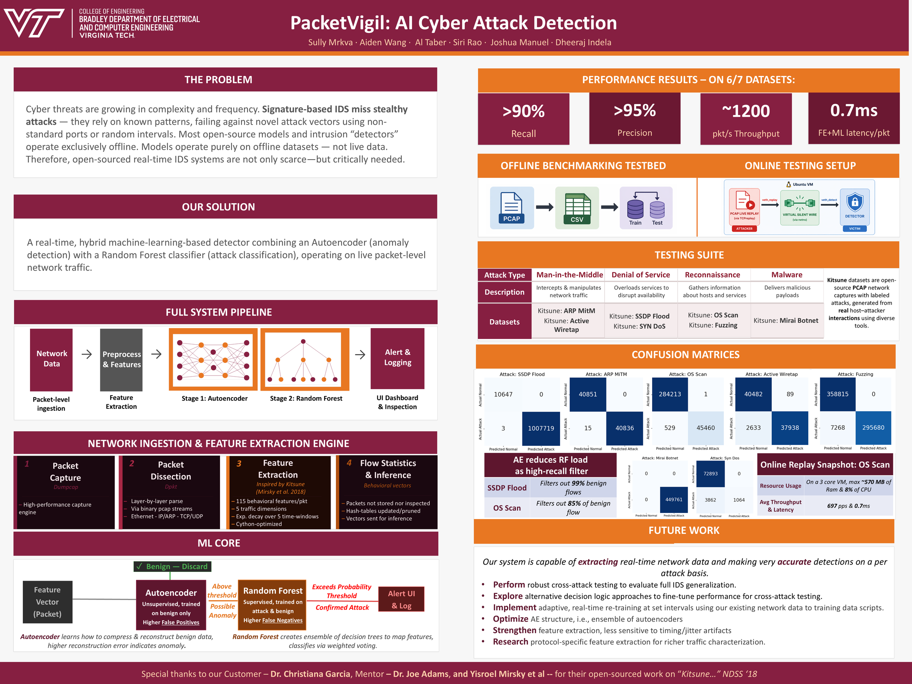

# PacketVigil: AI Cyberattack Detection

A real-time hybrid network intrusion detection system (NIDS) that combines an Autoencoder (AE) and Random Forest (RF) in a two-stage pipeline. Built for live network capture on Linux and offline PCAP replay, with a web dashboard for live monitoring.

[](docs/PacketVigil_Poster.pdf)

### Results at a glance

On 6 of the 7 test datasets (Kitsune attack scenarios), on a 3-core VM with no GPU:

| Recall | Precision | Throughput | FE+ML latency |
|---|---|---|---|
| >90% | >95% | ~1200 pkt/s | 0.7 ms / packet |

Details, including the SYN-DoS limitation, are in [docs/RESULTS.md](docs/RESULTS.md).

### Documentation

- [Architecture and design decisions](docs/ARCHITECTURE.md)
- [Module design](docs/MODULE_DESIGN.md)
- [Build and test results](docs/RESULTS.md)
- [Poster (PDF)](docs/PacketVigil_Poster.pdf) and [Final Project Binder (PDF)](docs/PacketVigil_Final_Project_Binder.pdf)

---

## How It Works

```
Raw packets → AfterImage (115 features) → AE reconstruction error
    → if error > AE_THRESHOLD → RF classifier → attack / benign verdict
```

1. **AfterImage / netStat** — Incrementally tracks per-flow and per-host statistics using exponential decay, producing 115 features per packet without storing raw traffic. These modules are adapted from the [Kitsune-py](https://github.com/ymirsky/Kitsune-py) project by Yisroel Mirsky (see [Acknowledgements](#acknowledgements)).
2. **Autoencoder** — Trained exclusively on benign traffic. Attack packets produce abnormally high reconstruction error.
3. **Random Forest** — Secondary classifier run only on AE-flagged packets to reduce false positives and give a final verdict.
4. **UI Bridge** — Pushes live alerts and metrics (precision, recall, F1) to the Dash dashboard every 5 seconds.

---

## Project Structure

```
├── NetworkIngestion/
│   ├── live_detector_linux.py      # Live capture detector (Linux)
│   ├── replay_detector.py          # Offline PCAP replay detector
│   ├── ui_bridge.py                # Writes alerts/metrics to UI/data/
│   ├── AfterImage.py               # Incremental network statistics
│   ├── netStat.py                  # Per-host / per-session stat tracking
│   ├── FeatureExtractor.py         # Kitsune-compatible feature extractor
│   └── HelperScripts/
│       ├── capture_only_linux.py   # Capture packets to PCAP (no detection)
│       ├── evaluate_detection.py   # Compute P/R/F1 from attack_log.json
│       ├── add_labels.py           # Label raw traffic CSVs
│       ├── pad_pcap.py             # Pad PCAP for replay alignment
│       └── setup_AfterImage.py     # Build AfterImage Cython extension
│
├── ML/
│   ├── autoencoder/
│   │   ├── Autoencoder.py          # AE model definition
│   │   ├── AE_train.py             # Training script
│   │   ├── AE_config.py            # Hyperparameters
│   │   ├── autoencoder.pt          # Trained model weights
│   │   └── scaler.pkl              # MinMaxScaler fitted on training data
│   ├── Hybrid Model/
│   │   ├── online_sequential_pipeline.py   # OnlineSequentialAERF class
│   │   ├── Hybrid_Train.py                 # Hybrid training script
│   │   └── Hybrid_Sequential_AE_RF.py      # Offline evaluation pipeline
│   └── rf_model.joblib             # Trained Random Forest model
│
├── UI/
│   ├── run_api.py                  # Entry point — starts Flask + Dash
│   ├── assets/
│   │   ├── custom.css              # Dashboard global styles
│   │   └── logo.svg                # Header logo
│   ├── data/                       # Runtime: alerts.json, metrics.json, config.json
│   ├── logs/                       # app.log
│   └── api/
│       ├── app.py                  # Flask app + Dash mount
│       ├── dash_layout.py          # Dashboard layout (3 tabs)
│       ├── dash_callbacks.py       # Dash callbacks
│       ├── api_routes.py           # REST API endpoints
│       ├── data_manager.py         # Thread-safe file I/O
│       └── config.py               # API/path configuration
│
└── Requirements.txt
```

---

## Setup

### Prerequisites

**Linux (detector host):**
- Python 3.10+
- `dumpcap` or `tcpdump` for live capture
- `tshark` if using the replay detector

**Windows (optional, replay only):**
- Wireshark installed at `D:\Wireshark\tshark.exe`

### Install dependencies

```bash
pip install torch scikit-learn pandas numpy dpkt flask flask-cors dash dash-bootstrap-components psutil joblib
```

### Network namespace setup (live detection)

The live detector expects a network namespace `detect_ns` and virtual interface `veth_detect`. Set these up before running:

```bash
sudo ip netns add detect_ns
sudo ip link add veth_detect type veth peer name veth_host
sudo ip link set veth_detect netns detect_ns
sudo ip netns exec detect_ns ip link set veth_detect up
sudo ip link set veth_host up
```

---

## Running

### 1. Start the dashboard

```bash
cd UI
python run_api.py
```

Dashboard: `http://localhost:5000/dashboard/`  
API: `http://localhost:5000/api`

### 2. Run live detection (Linux)

```bash
sudo python3 -m NetworkIngestion.live_detector_linux
```

Captures on `veth_detect` inside `detect_ns`, runs 86,890 AfterImage warm-up packets, then begins ML inference. Alerts and metrics stream to the dashboard automatically.

### 3. Run offline PCAP replay (Windows/Linux)

```bash
python -m NetworkIngestion.replay_detector
```

Edit `REPLAY_PCAP` in `replay_detector.py` to point to your PCAP file.

### 4. Evaluate results

```bash
python -m NetworkIngestion.HelperScripts.evaluate_detection
```

Compares `NetworkIngestion/attack_log.json` against a ground-truth labels CSV and prints precision, recall, F1, and ROC-AUC.

---

## Configuration

Key constants at the top of `live_detector_linux.py`:

| Constant | Default | Description |
|---|---|---|
| `INTERFACE` | `veth_detect` | Capture interface |
| `NAMESPACE` | `detect_ns` | Network namespace |
| `AE_THRESHOLD` | `2.8` | AE reconstruction error cutoff |
| `RF_THRESHOLD` | `0.5` | RF attack probability cutoff |
| `WARMUP_PACKETS` | `86890` | Packets fed to AfterImage before ML starts |
| `TEST_SIZE` | `330204` | Size of labelled test set for live P/R/F1 |
| `LABELS_CSV` | `UI/OS Scan_labels.csv` | Ground-truth labels for evaluation |

Threshold sliders in the Settings tab of the dashboard update thresholds at runtime without restarting detection.

---

## Dashboard

Three tabs:

- **Dashboard** — Live metrics cards (system status, P/R/F1, alert count, resource usage, thresholds, alert rate) and a live attack feed table that auto-refreshes every 5 seconds.
- **Anomaly Inspector** — Full alert table with verdict/date filtering, sorting, and pagination.
- **Settings** — AE and RF threshold sliders with live apply.

---

## Acknowledgements

PacketVigil was built by Sully Mrkva, Aiden Wang, Al Taber, Siri Rao, Joshua Manuel, and Dheeraj Indela as an ECE capstone project at Virginia Tech. Thanks to our customer, Dr. Christiana Garcia, and our mentor, Dr. Joe Adams.

The feature-extraction layer in `NetworkIngestion/` (`AfterImage.py`, `netStat.py`, and the Cython variant `AfterImage_cy`) is derived from **[Kitsune-py](https://github.com/ymirsky/Kitsune-py)** by Yisroel Mirsky, released under the MIT License (Copyright (c) 2018 Yisroel Mirsky). The 115-feature damped incremental statistics approach (AfterImage) originates from that work. PacketVigil's own contributions, including the autoencoder + Random Forest hybrid pipeline, live/replay detectors, and the dashboard, are separate from it. `FeatureExtractor.py` follows the Kitsune feature layout.

If you use this project, please also cite the original paper:

> Y. Mirsky, T. Doitshman, Y. Elovici, and A. Shabtai, "Kitsune: An Ensemble of Autoencoders for Online Network Intrusion Detection," *Network and Distributed System Security Symposium (NDSS)*, 2018.
