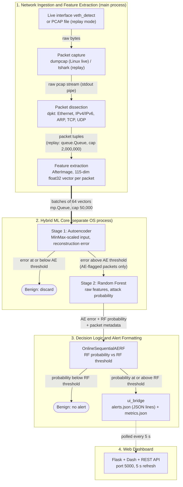
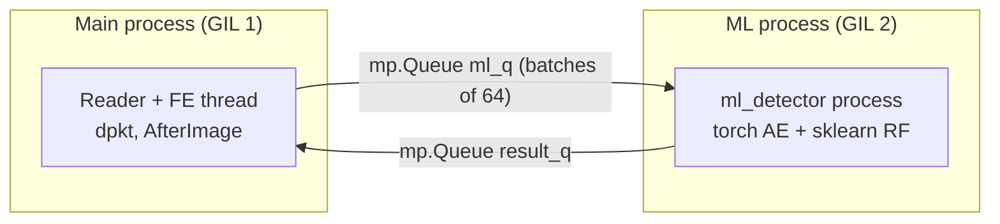

# PacketVigil Architecture

How PacketVigil is put together, and why. For module-level detail see [MODULE_DESIGN.md](MODULE_DESIGN.md); for measured results see [RESULTS.md](RESULTS.md).

## Contents

- [Architecture style](#architecture-style)
- [High-level architecture](#high-level-architecture)
- [Subsystems](#subsystems)
- [Following one packet](#following-one-packet)
- [Design decisions](#design-decisions)
- [Feature engine deep dive (AfterImage)](#feature-engine-deep-dive-afterimage)
- [Concurrency architecture](#concurrency-architecture)
- [Throughput bottlenecks](#throughput-bottlenecks)

---

## Architecture style

PacketVigil is a **pipe-and-filter**, **layered** system with **concurrent** (multi-thread plus multi-process) execution.

- **Pipe-and-filter.** Packets move one way through independent stages (capture, parse, feature extraction, AE, RF, decision, alerting). Stages talk only through bounded queues. This keeps each stage small and testable, and the queues absorb bursts so a traffic spike upstream does not stall the stages downstream (needed for the 600 pps throughput target).
- **Layered.** Data is progressively abstracted: raw bytes, then packet headers, then 115-dimensional behavioral vectors, then ML decisions, then human-facing alerts. A layer talks only to its neighbours, so an implementation can be swapped without touching the rest (for example dumpcap for live capture versus tshark for PCAP replay).
- **Concurrent.** Because the stages only share queues, the most expensive stage (the ML core) can be moved into its own OS process and so escape Python's Global Interpreter Lock (GIL). Without that split, the sub-millisecond per-packet latency target is not reachable on a 3-core VM.

## High-level architecture

Notes on the diagram:

- ML scoring runs in 256-vector batches inside the ML process (live detector); all AE-flagged packets in a batch go through the RF in a single `predict_proba()` call.
- In live mode, parsing and feature extraction run in one thread. In replay mode they are two threads joined by the 2,000,000-entry `queue.Queue`.
- The strict AE-then-RF ordering is deliberate; see [Design decisions](#design-decisions).

## Subsystems

| # | Subsystem | Purpose | Input | Output | Key files |
|---|---|---|---|---|---|
| 1 | Network Ingestion and Feature Extraction | Capture packets, parse headers, produce a 115-dim behavioral vector per packet. No payloads are stored, only running statistics. | Live interface or PCAP file | 115-dim float32 vectors, batched 64 at a time | [`NetworkIngestion/live_detector_linux.py`](../NetworkIngestion/live_detector_linux.py), [`replay_detector.py`](../NetworkIngestion/replay_detector.py), [`AfterImage.py`](../NetworkIngestion/AfterImage.py), [`AfterImage_cy.pyx`](../NetworkIngestion/AfterImage_cy.pyx), [`netStat.py`](../NetworkIngestion/netStat.py), [`FeatureExtractor.py`](../NetworkIngestion/FeatureExtractor.py) |
| 2 | Hybrid ML Core (AE then RF) | Score every vector with the AE; run the RF only on AE-flagged vectors. Runs in its own OS process to bypass the GIL. | Batches of vectors from `mp.Queue` | Per-packet AE error, RF probability (when computed) | [`ML/autoencoder/`](../ML/autoencoder), [`ML/rf_model.joblib`](../ML/rf_model.joblib) |
| 3 | Decision Logic and Alert Formatting | Apply the AE and RF thresholds, format confirmed attacks into the alert schema, write them to disk. Default verdict is benign. | Per-packet ML results plus packet metadata | JSON-lines alerts and a metrics file in `UI/data/` | [`ML/Hybrid Model/online_sequential_pipeline.py`](../ML/Hybrid%20Model/online_sequential_pipeline.py), [`NetworkIngestion/ui_bridge.py`](../NetworkIngestion/ui_bridge.py) |
| 4 | Web Dashboard | Show status, metrics, resource usage and alerts; expose a REST API. | `alerts.json`, `metrics.json` | Dash UI and REST endpoints | [`UI/api/`](../UI/api), [`UI/run_api.py`](../UI/run_api.py) |

## Following one packet

1. **Network interface.** The packet arrives on the monitored interface (`veth_detect` in the test VM), or is read from a PCAP in replay mode.
2. **Capture.** `dumpcap` (Linux live) or `tshark` (replay) emits it. In live mode `dumpcap -i veth_detect -B 256 -P -w -` writes a raw pcap byte stream to stdout, which the detector reads through a subprocess pipe. No intermediate files touch disk.
3. **Dissection.** The live detector parses the stream with a small hand-written pcap reader plus `dpkt`: Ethernet, then IPv4/IPv6 or ARP, then TCP, UDP or ICMP. It extracts MACs, IPs, ports, protocol, original wire length and timestamp into a lightweight tuple. In replay mode a reader thread pushes tshark's tab-separated lines into a bounded `queue.Queue` (2,000,000), which gives backpressure.
4. **Feature extraction.** AfterImage updates its running statistics for the packet's host, host pair, channel, socket and jitter, across five decay windows, and returns one 115-dim float32 vector. Vectors are batched (64 in the live detector) and put on a multiprocessing queue (cap 50,000) that crosses into the ML process.
5. **Stage 1: autoencoder.** The ML process scales the vector with the persisted `MinMaxScaler`, reconstructs it, and computes mean-squared reconstruction error. At or below the AE threshold: decided benign and discarded, never reaching the RF. This is the load-shedding step. On SSDP Flood about 99% of benign packets stop here.
6. **Stage 2: random forest.** Above the threshold, the packet's *raw* (unscaled) vector goes to the 400-tree RF, which returns an attack probability.
7. **Decision logic.** `OnlineSequentialAERF` compares the probability to the RF threshold. At or above: verdict is attack. Below: benign, no alert. It also maintains counters (packets seen, AE flags, RF calls, confirmed attacks).
8. **Alert log.** For confirmed attacks `ui_bridge` formats the alert schema and appends one JSON line to `UI/data/alerts.json`. One object per line lets the dashboard read incrementally. This is the boundary between the detector and the dashboard.
9. **Dashboard.** The Flask + Dash app polls `alerts.json` and `metrics.json` every 5 seconds and updates the Dashboard, Anomaly Inspector and Settings tabs; the same data is available over REST.

## Design decisions

| Decision | Alternative considered | Why |
|---|---|---|
| **Sequential cascade: AE filters, RF confirms** | The original design draft ran the AE and RF in parallel and fused them in a decision block | Parallel evaluation runs the (much costlier) RF on every packet, although most traffic is benign. The cascade cuts the RF's load by 85-99% on the tested attacks, which is what makes sub-millisecond per-packet latency feasible. The two models also fail differently: the AE is high-recall with more false positives, the RF tightens precision. |
| **ML core in a separate OS process** | Run the ML as a thread beside capture and feature extraction | The GIL serializes Python bytecode across threads, so compute-heavy ML and I/O-heavy capture plus feature extraction would take turns. Separate processes land on different cores. The cost is pickling at the queue boundary, addressed by batching. |
| **Batching: 64 vectors per queue put, 256 per AE forward pass** | Send one vector at a time | Queue IPC latency (roughly 0.1-1 ms per `put()`) would dominate. Batching 64 packets per put cuts it 64x; vectors are stacked into one numpy array so they pickle in one copy. A 256-row AE pass amortizes torch overhead, and the RF is called once per batch on all flagged rows. |
| **`dumpcap` + `dpkt` for live capture** | `tshark` for everything | tshark carries conversation tables, DNS caches and TCP reassembly buffers that add overhead and memory. dumpcap just hands raw bytes over, and dpkt parses only the headers needed. tshark remains in the replay detector, where it reads PCAP files. |
| **Packet-level vectors** | The original plan built flow-level records and CSVs | Per-packet vectors let the system make a decision on every packet as it arrives (no waiting for a flow to end), which supports real-time alerting. |
| **No payload storage** | Store or inspect packets | Only running statistics are kept. This limits the privacy surface and bounds memory. |
| **Adapt Kitsune's AfterImage** | Write a feature extractor from scratch | The damped-incremental-statistics approach is proven for online NIDS; it is credited to Kitsune-py (see the root README acknowledgements). A Cython variant (`AfterImage_cy.pyx`) provides a 3-5x speedup at high packet rates, per the project report. |
| **Bounded queues and bounded hash tables** | Unbounded buffers | Memory stays predictable: peak memory was 572-991 MB on the 3-core VM across tested runs. |

## Feature engine deep dive (AfterImage)

`NetworkIngestion/AfterImage.py` is an incremental statistics engine. It keeps exponentially weighted statistics per observed flow and never stores raw packets.

- **`incStat`** tracks one uni-directional stream identified by a string key (for example a source IP). On every packet it applies exponential decay (`processDecay`) so old observations lose influence and recent ones dominate.
- **`incStat_cov`** links two `incStat` objects (for example a src to dst pair) and tracks their joint statistics.
- **`incStatDB`** is the container: a dict keyed by `"<flow_ID>_<Lambda>"` mapping to `incStat` objects.
- **`netStat`** (`NetworkIngestion/netStat.py`) is the top-level manager. It owns four `incStatDB` tables and exposes `updateGetStats()`, which takes one parsed packet and returns the full 115-element vector.

### The four hash tables

| Table | Key | Value tracked | Purpose |
|---|---|---|---|
| `HT_MI` | source MAC + source IP | datagram size | MAC-IP relationship bandwidth stats |
| `HT_H` | source IP (paired with destination IP) | datagram size | Host-to-host bandwidth stats |
| `HT_jit` | source IP + destination IP | inter-arrival time | Host-to-host jitter stats |
| `HT_Hp` | ARP: src/dst MAC; TCP/UDP: src IP+port / dst IP+port | datagram size | Session/channel bandwidth and correlation |

### Capacity limits

| Table | Default limit | Hard cap |
|---|---|---|
| `HT_jit` | HostLimit squared | 200,000 |
| `HT_MI` | HostLimit x 10 | 200,000 |
| `HT_H` | HostLimit | 50,000 |
| `HT_Hp` | HostLimit squared x HostLimit (SessionLimit) | 200,000 |

The live detector constructs `netStat` with `maxHost = maxSess = 100000`, so in practice the hard caps apply.

### Decay windows

Five decay factors run simultaneously, `lambda` in {5, 3, 1, 0.1, 0.01}:

| Lambda | Half-life | Captures |
|---|---|---|
| 5 | 0.14 s | Sub-second bursts and spikes |
| 3 | 0.23 s | Fast flows |
| 1 | 0.69 s | About a one-second window |
| 0.1 | 6.9 s | About ten-second trends |
| 0.01 | 69 s | About two-minute background baseline |

### Memory protection

- **LRU batch pruning.** When a table reaches 95% of its limit and a new key must be registered, a batch sweep evicts the least-recently-used entries together. One sort per batch replaces one linear scan per eviction; the project report estimates 5-10x faster at 500k-entry tables.
- **Per-flow covariance cap.** `MAX_COVS = 50`: if either stream already has 50 covariance entries, the oldest (by last timestamp) is evicted from both streams before a new pair is added. This stops one busy flow from accumulating unbounded cross-stream state.
- **Warm-up.** The live and replay detectors feed the first 86,890 packets through AfterImage before ML scoring starts, so running statistics match the baseline the models were trained on.

## Concurrency architecture

- The ML pipeline (PyTorch AE, scikit-learn RF) is CPU-bound. Running it in an `mp.Process` gives it its own GIL and core, so it runs truly in parallel with feature extraction.
- `ml_q` is a `multiprocessing.Queue`, which serializes via pickle. Vectors are therefore stacked into one numpy array per batch (a single buffer copy) rather than 64 separate arrays.
- In replay mode, `packet_q` is a plain `queue.Queue` between two threads: thread-safe, with no serialization cost.
- If the ML process dies, the parent logs it and stops rather than silently restarting, so a real fault is not masked.

## Throughput bottlenecks

In order of cost, from the project report (estimates, not benchmarks of this repo):

1. **AfterImage.** The innermost loop: each `updateGetStats()` does on the order of 20 dict lookups and 100 float multiplications plus covariance updates. Roughly 0.5-2 ms per packet in pure Python versus 0.1-0.4 ms with Cython.
2. **`mp.Queue` IPC.** Pickling a 64-vector numpy batch is cheap; the dominant cost is the pipe write/read (roughly 0.1-1 ms per `put()`), which batching divides by 64.
3. **AE forward pass.** A `(256, 115)` float32 batch on CPU takes roughly 1-5 ms, so about 0.004-0.02 ms per packet amortized.
4. **RF `predict_proba`.** Only on AE-flagged packets. At a 5% flag rate on a 256-packet batch that is about 13 rows with 400 trees, roughly 0.5-2 ms per batch.

Measured end-to-end results (0.3-0.7 ms FE+ML per packet, 697-1272 pps on a 3-core VM) are in [RESULTS.md](RESULTS.md).
