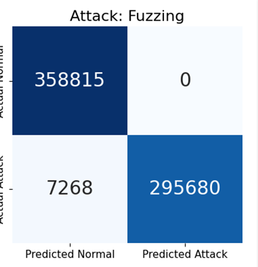
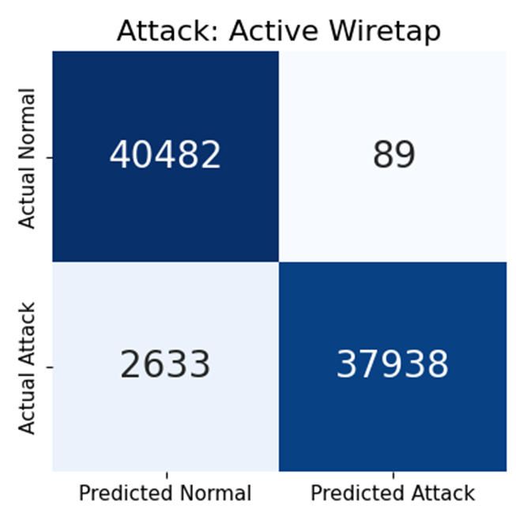
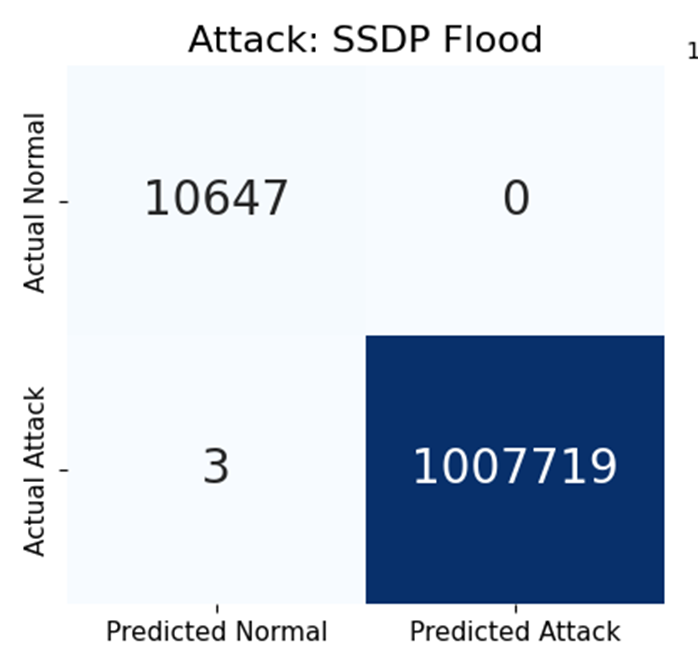
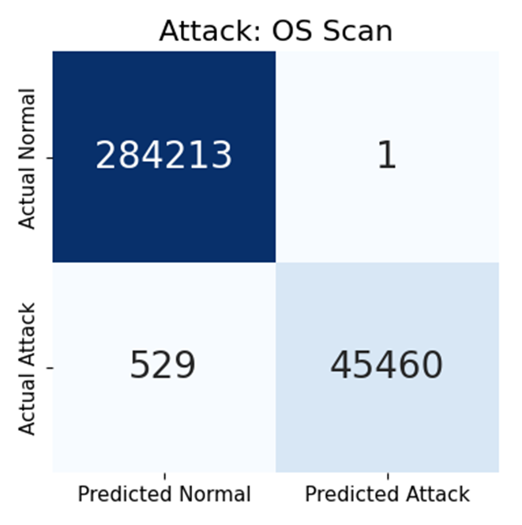
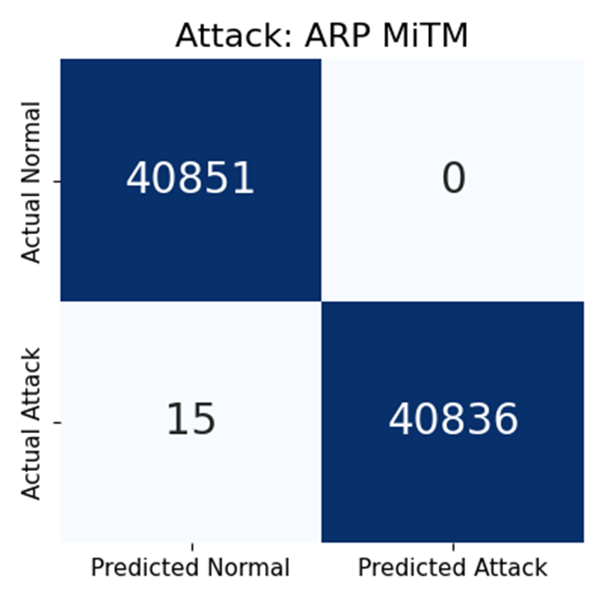
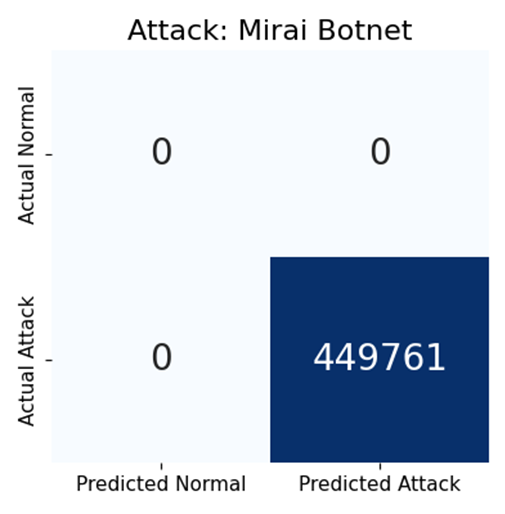

# PacketVigil Build and Test Results

How PacketVigil was tested and what it achieved. Sources: the project binder and poster in this folder ([poster PDF](PacketVigil_Poster.pdf), [binder PDF](PacketVigil_Final_Project_Binder.pdf)).

## Contents

- [Headline numbers](#headline-numbers)
- [Test setup](#test-setup)
- [Datasets and testing suite](#datasets-and-testing-suite)
- [Offline results](#offline-results)
- [Confusion matrices](#confusion-matrices)
- [Online results](#online-results)
- [The AE as a high-recall filter](#the-ae-as-a-high-recall-filter)
- [Requirements verification](#requirements-verification)
- [Known limitations](#known-limitations)
- [Lessons learned](#lessons-learned)
- [Future work](#future-work)

## Headline numbers

On 6 of the 7 test datasets:

| Metric | Result |
|---|---|
| Recall | greater than 90% (93% or better) |
| Precision | greater than 95% (100% on 6/7 offline datasets) |
| Throughput | about 1200 packets/s (697-1272 pps observed online) |
| FE+ML latency | 0.7 ms per packet (0.3-0.7 ms observed) |
| Hardware | 3-core Ubuntu VM, no GPU; peak memory 572-991 MB |

The one exception is SYN-DoS (recall 22%); see [Known limitations](#known-limitations).

## Test setup

**Offline benchmarking testbed.** Each attack PCAP is converted to a labeled CSV of per-packet feature vectors, then split into train and test sets. Test sets were temporally sampled to balance attack and benign packets 1:1, except SYN-DoS and Mirai Botnet, whose attack volume was so large that no temporal split could balance them. (SSDP Flood is imbalanced too, but its false-positive count is tiny, so imbalance does not inflate the statistics.)

**Online testing setup.** A safe, repeatable live sandbox on an Ubuntu VM (3 cores):

```text
PCAP live replay (tcpreplay)  ->  veth_replay  ->  virtual "silent wire" (network namespace)  ->  veth_detect  ->  PacketVigil detector
        (attacker side)                                                                                          (victim side)
```

PCAPs are replayed with `tcpreplay` onto `veth_replay`; the traffic crosses a virtual wire built with Linux network namespaces and arrives on `veth_detect`, where the live detector captures it exactly as it would from a real interface. No real network is touched. The setup commands are in the root [README](../README.md#network-namespace-setup-live-detection).

## Datasets and testing suite

The Kitsune datasets are open-source PCAP captures with labeled attacks, generated from real host-attacker interactions using diverse tools. CIC-IDS-2017 was used for the initial benchmark.

| Attack category | Description | Kitsune datasets |
|---|---|---|
| Man-in-the-Middle | Intercepts and manipulates network traffic | ARP MitM, Active Wiretap |
| Denial of Service | Overloads services to disrupt availability | SSDP Flood, SYN DoS |
| Reconnaissance | Gathers information about hosts and services | OS Scan, Fuzzing |
| Malware | Delivers malicious payloads | Mirai Botnet |

## Offline results

"AE" columns evaluate the autoencoder alone; "Sequential" columns are the full AE then RF pipeline.

| Dataset | AE precision | AE recall | AE F1 | RF F1 | Seq. precision | Seq. recall | Seq. F1 | Passed to RF |
|---|---|---|---|---|---|---|---|---|
| Fuzzing | 49.0% | 98.8% | 65.5% | 99.4% | 100.0% | 97.6% | 98.8% | Attack 98.80% / Benign 86.82% |
| Active Wiretap | 60.5% | 93.3% | 73.4% | 83.8% | 100.0%* | 93.5% | 96.5% | Attack 93.25% / Benign 60.96% |
| SYN-DoS | 96.2% | 100.0% | 98.1% | 35% | 100.0% | 22% | 35.5% | Attack 100.00% / Benign 0.27% |
| SSDP Flood (imbalanced) | 100.0% | 100.0% | 100.0% | 100.0% | 100.0% | 100.0% | 100.0% | Attack 100.00% / Benign 0.15% |
| OS Scan | 51% | 98.85% | 67% | 99.9% | 100% | 98.85% | 99.42% | Attack 98.85% / Benign 15.17% |
| ARP MitM | 49.99% | 99.96% | 66.65% | 100.00% | 100.00% | 99.96% | 99.98% | Attack 99.96% / Benign 100.00% |
| Mirai Botnet | 100% | 100% | 100% | 100% | 100% | 100% | 100% | N/A |

\* The Active Wiretap confusion matrix below shows 89 false positives out of 38,027 predicted attacks (about 99.8% precision); the binder table rounds this to 100.0%.

Reading the table: the AE alone has high recall but modest precision on balanced sets (it flags anything unusual); the RF then removes the false alarms, giving near-perfect sequential precision.

## Confusion matrices

Offline, sequential AE then RF pipeline. Rows are actual, columns are predicted.

<table>
  <tr>
    <td align="center"><br><sub>Fuzzing</sub></td>
    <td align="center"><br><sub>Active Wiretap</sub></td>
    <td align="center"><br><sub>SYN DoS</sub></td>
  </tr>
  <tr>
    <td align="center"><br><sub>SSDP Flood</sub></td>
    <td align="center"><br><sub>OS Scan</sub></td>
    <td align="center"><br><sub>ARP MitM</sub></td>
  </tr>
  <tr>
    <td align="center"><br><sub>Mirai Botnet (attack-only test set)</sub></td>
    <td></td>
    <td></td>
  </tr>
</table>

The Fuzzing matrix is cropped from the project poster (the binder's figure set omits it).

## Online results

Live replay through the veth/netns testbed on the 3-core Ubuntu VM.

| Dataset | Precision / Recall / F1 | Confusion counts | Peak memory | CPU capacity used | Throughput | FE+ML latency per packet |
|---|---|---|---|---|---|---|
| Fuzzing | 1.0000 / 0.9991 / 0.9995 | TP 302,671, FP 10, TN 358,805, FN 277 | 991.3 MB | ~22% | 1231 pps | ~0.7 ms |
| SSDP Flood | 1.00 / 0.99 / 1.00 | TP 590,011, FP 13, TN 6,863, FN 3,113 | 948.6 MB | ~59% | 1272 pps | ~0.7 ms |
| OS Scan | 1.00 / 0.9937 / 0.9968 | not listed in binder | 572.3 MB | ~8% | 697 pps | ~0.3 ms |

Online test datasets:

| Dataset | Test-set packets | Transmission time | Average rate | True negatives (benign) | True positives (attack) |
|---|---|---|---|---|---|
| Fuzzing | 661,763 | ~28 min | ~1291 pps | 358,815 | 299,306 |
| SSDP Flood | ~600k | ~30 min | ~1400 pps, peaks at 25,000 | 6,863 | 590,011 |
| OS Scan | 330,204 | ~10 min | 712 pps | 284,213 | 45,936 |

Note: the binder's Fuzzing attack count (299,306) differs slightly from TP+FN in the results table above (302,948); both are reproduced as published.

## The AE as a high-recall filter

The AE is not the final classifier; its job is to shed benign load so the RF stays cheap.

- **SSDP Flood:** about 99% of benign packets are filtered out before the RF (0.15% reach it).
- **OS Scan:** about 85% of benign packets are filtered out (15.17% reach it).
- Across the tested attacks the RF's effective load drops by 85-99%.

## Requirements verification

Condensed from the binder's requirements matrix and target-specification table. "Target" is the ideal target from the binder.

| Requirement | Metric | Target | Achieved | Status |
|---|---|---|---|---|
| PER-2 | Precision, offline | 95% or more | 100% on 6/7 datasets | Met |
| PER-3 | Precision, real-time | 90% or more (marginal 80%) | 99% or more on tested datasets | Met |
| PER-3 | False positive rate | 5% or less | under 1% on 6/7 datasets | Met |
| PER-5 | Recall, offline | 95% or more | 93% or more on 6/7 datasets; SYN-DoS 22% | Partially met |
| PER-6 | Recall, real-time | 85% or more (marginal 80%) | 93% or more on 6/7 datasets | Met (except SYN-DoS) |
| PER-4 | Alert latency | within 10 s hard bound; 1 s goal | 0.3-0.7 ms per packet FE+ML | Met |
| PER-7 | FE+ML latency | under 1 ms per packet | ~0.3-0.7 ms | Met |
| PER-8 | Throughput | 1000 pps (marginal 600) | 697-1272 pps | Met |
| POW-1 | Hardware | commodity VM, no GPU | 3-core Ubuntu VM, no GPU | Met |
| POW-2 | Peak memory | under 1000 MB (marginal 1500) | 572-991 MB | Met |
| CON-1 | Role-based access control | n/a | not built | Deferred |

All other requirements (FUN-1 to FUN-7, I/O-1 to I/O-3, REL-1, TEST-1/2, COM-1, ENV-1, COST-1, SCH-1/2) are marked Met in the binder.

### Test cases

| ID | Checks | Summary |
|---|---|---|
| TC-1 | FUN-1, FUN-2, FUN-7, I/O-1 | Replay every Kitsune PCAP end to end; one 115-dim vector per packet, no exceptions |
| TC-2 | FUN-3, PER-5 | AE-only stage: recall high enough (98% or more on six of seven datasets) to act as a filter |
| TC-3 | FUN-3, PER-2, PER-5 | Full sequential pipeline: precision and recall of 95% or more; SYN-DoS reported as a known partial case |
| TC-4 | FUN-4, FUN-6, I/O-2 | Every RF-confirmed attack yields exactly one schema-valid line in `alerts.json` |
| TC-5 | FUN-5, I/O-3 | Dashboard refreshes during replay; thresholds adjustable via UI and `POST /api/threshold` |
| TC-6 | PER-4, PER-7 | Mean per-packet FE+ML latency under 1 ms |
| TC-7 | PER-1, PER-8 | Sustained throughput of 600 pps or more (1000 on Fuzzing and SSDP Flood); zero ingestion drops |
| TC-8 | POW-1, POW-2, ENV-1 | Peak memory 1.5 GB or less on the 3-core VM; CPU headroom for bursts |
| TC-9 | TEST-1, TEST-2 | Retrain AE, scaler and RF from a clean checkout; metrics reproduce |
| TC-10 | REL-1 | Multi-million-packet long-form replay completes without crashing |
| TC-11 | COM-1 | Alert fields match NIST SP 800-94 recommendations |

## Known limitations

- **SYN-DoS recall is 22%.** The AE alone catches essentially all SYN-DoS packets (recall 100%, precision 96.2%), but the RF fails to learn the attack pattern (RF F1 35%), so the sequential pipeline reaches 100% precision at only 22% recall (3,862 attack packets missed in the offline matrix). This is the main open problem.
- **Timing sensitivity.** Replay jitter distorts time-based features and can degrade detection accuracy.
- **Per-attack thresholds.** AE and RF thresholds were tuned per attack profile; the system assumes deployment traffic resembles the training baseline and needs retraining on very different networks.
- **Validated in a virtualized testbed only**; online results cover three attacks (Fuzzing, SSDP Flood, OS Scan).
- No role-based access control (deferred).

## Lessons learned

- Choosing the feature-extraction approach was the hardest design problem: ingest live traffic and extract useful metadata without breaking real-time behavior took research and repeated redesign.
- Most academic work benchmarks only on offline CSVs. Building a replicable, safe online test sandbox was a project of its own.
- Planning against a structured timeline and forming sub-teams around key design checkpoints improved productivity as the year went on.

## Future work

- **Cross-attack generalization.** The most promising direction. An autoencoder trained exclusively on OS Scan traffic achieved greater than 95% precision, recall and F1 on Fuzzing traffic, suggesting the AE generalizes across structurally different attacks. Expand this testing to evaluate full IDS generalization.
- **Alternative decision logic**, such as ensembles or weighted voting, to improve robustness across attack types (and to address the SYN-DoS RF weakness).
- **Adaptive, real-time retraining** at set intervals using the existing network-data-to-training-data scripts.
- **Optimize the AE**, for example an ensemble of autoencoders.
- **Strengthen feature extraction** so it is less sensitive to timing and jitter artifacts.
- **Protocol-specific feature extraction** for richer traffic characterization.
- Role-based access control for logs and configuration (deferred requirement CON-1).
